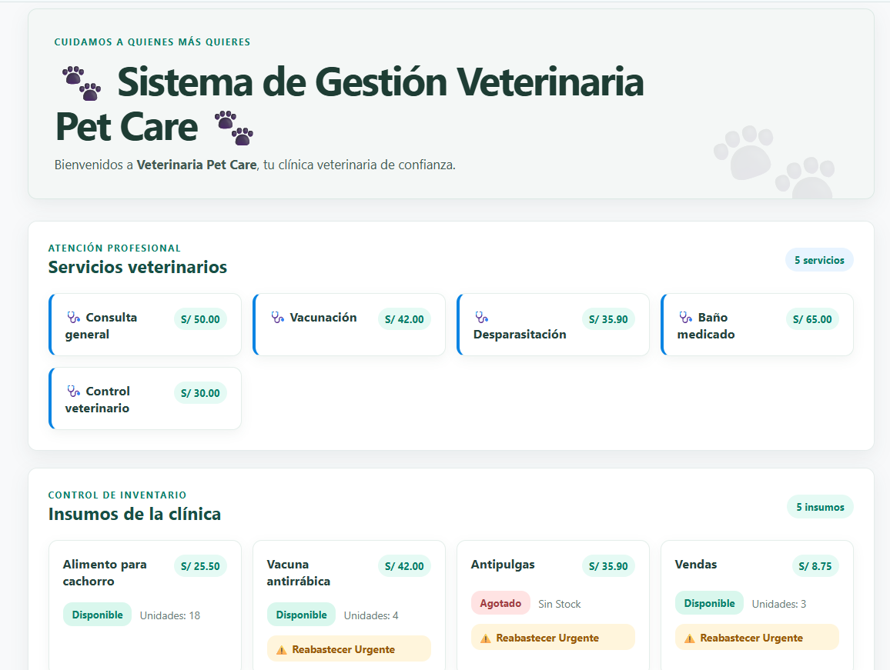
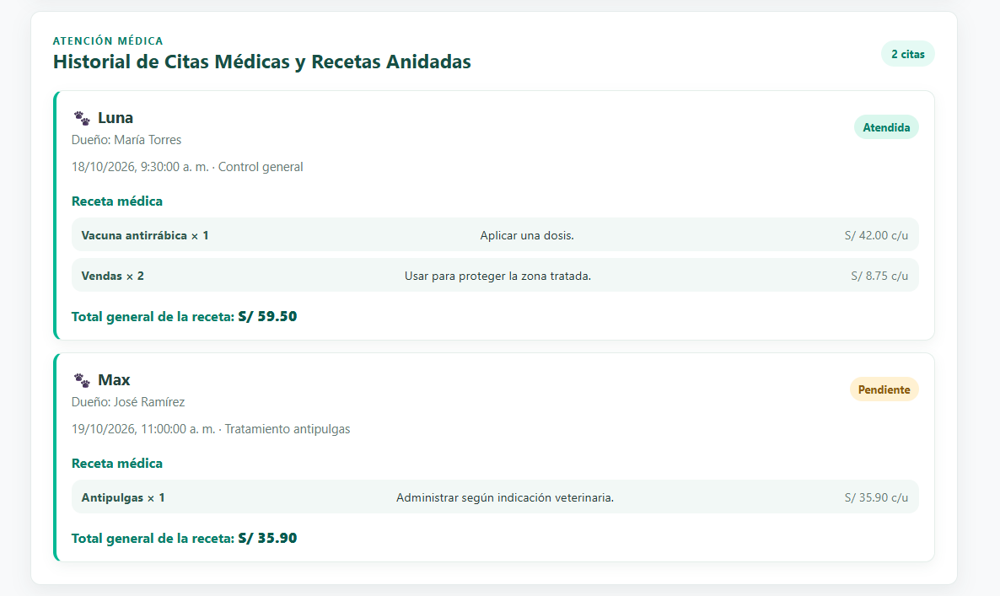

# Sistema de Gestión Veterinaria — Frontend React + Vite (Semana 09)

Este proyecto corresponde al desarrollo de la interfaz de usuario de tipo **Single Page Application (SPA)** para el sistema de gestión **Veterinaria Pet Care**, construida con **React** y bundler **Vite**. Esta etapa marca el inicio del desacoplamiento total entre la capa visual (Frontend) y la capa de servicios (API REST en Django).

---

## Características Principales e Implementaciones

1. **Arquitectura Single Page Application (SPA) Desacoplada:**
   * Creación del proyecto independiente en la carpeta `/frontend` utilizando React con sintaxis **JSX**.
   * Punto de entrada único a través de `index.html` con inyección dinámica del componente raíz `App.jsx` mediante `src/main.jsx`.

2. **Renderizado Dinámico de Colecciones con JSX:**
   * Recorrido iterativo de listas de datos (`servicios`, `insumos`, `citasMedicas`) utilizando el método funcional `.map()`.
   * Garantía de reconciliación eficiente en el DOM mediante el uso de atributos clave unívocos (`key={item.id}`).

3. **Renderizado Condicional y Gestión de Alertas:**
   * Implementación de operadores ternarios y evaluación de cortocircuito (`&&`) para mostrar etiquetas de estado de inventario (*Disponible*, *Agotado*, *⚠️ Reabastecer Urgente*).
   * Manejo dinámico de estados vacíos notificando en pantalla cuando no existen registros cargados en el sistema.

4. **Modelado de Relaciones Anidadas (1:N) y Cálculos en Cliente:**
   * Representación estructurada de atenciones médicas (*Cita Médica* $\rightarrow$ *Receta e Insumos*) replicando el formato JSON expuesto por la API REST de la Semana 08.
   * Cálculo en tiempo real del costo acumulado de medicamentos y servicios recetados por cada cita médica.

5. **Estilización Veterinaria Temática y Calidad de Código:**
   * Maquetación visual limpia y profesional con paleta de colores médica/veterinaria, tarjetas con sombras suaves, badges de estado y diseño responsivo (`App.css`).
   * Verificación de sintaxis, buenas prácticas y compilación de producción mediante los comandos de validación `npm run lint` y `npm run build`.

---

## Estructura del Proyecto Frontend

```text
Semana 09/
└── frontend/
    ├── public/
    │   └── favicon.svg
    ├── src/
    │   ├── assets/
    │   ├── App.css
    │   ├── App.jsx
    │   └── main.jsx
    ├── .gitignore
    ├── index.html
    ├── package.json
    └── vite.config.js

```
## Ejecución

Desde la carpeta `Semana 09`, ejecuta:

```powershell
cd frontend
npm install
npm run dev
```

Vite mostrará la dirección local del servidor de desarrollo (normalmente `http://localhost:5173/`).

## Datos

Los servicios, insumos, citas y detalles de receta son datos estáticos escritos en JavaScript, con una estructura basada en las respuestas de la API REST del Laboratorio 08. Esta versión no consume la API ni realiza solicitudes HTTP.

## Captura Final


