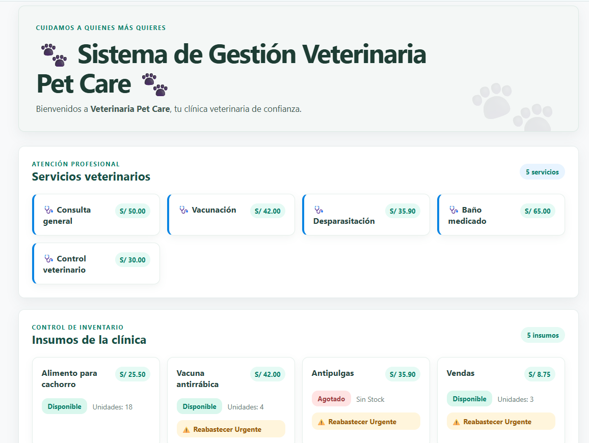
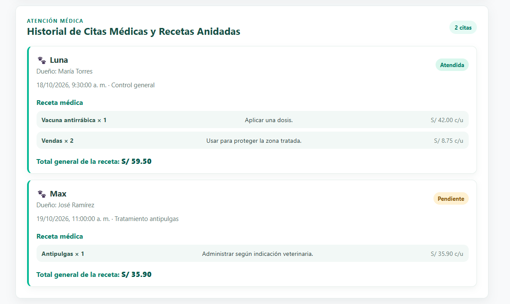

# Sistema de Gestión Veterinaria — Frontend React + Vite (Semana 10)

Este proyecto corresponde a la interfaz de usuario de tipo **Single Page Application (SPA)** para el sistema de gestión **Veterinaria Pet Care**, construida con **React** y **Vite**. Los datos de esta etapa son estáticos y no se realizan solicitudes HTTP.

---

## Características Principales e Implementaciones

1. **Componentes React:**
   * Datos estáticos de insumos, servicios y citas en `src/datos.js`.
   * Componentes reutilizables para tarjetas, formularios, insumos, citas y detalles de recetas en `src/components/`.

2. **Gestión de insumos:**
   * Alta mediante un formulario controlado que valida precio mayor a cero y stock no negativo.
   * Búsqueda por nombre sin distinguir mayúsculas y minúsculas.
   * Solicitud de insumos con estado local y botón deshabilitado cuando no hay existencias.

3. **Citas y recetas:**
   * Renderizado de los detalles de receta con `.map()` y claves estables.
   * Cálculo en cliente del costo total de insumos por cita.

4. **Estilización y calidad de código:**
   * Maquetación visual limpia y profesional con paleta de colores médica/veterinaria, tarjetas con sombras suaves, badges de estado y diseño responsivo (`App.css`).
   * Verificación de sintaxis, buenas prácticas y compilación de producción mediante los comandos de validación `npm run lint` y `npm run build`.

---

## Estructura del Proyecto Frontend

```text
Semana 10/
└── frontend/
    ├── public/
    │   └── favicon.svg
    ├── src/
    │   ├── assets/
    │   ├── components/
    │   ├── datos.js
    │   ├── App.css
    │   ├── App.jsx
    │   └── main.jsx
    ├── .gitignore
    ├── index.html
    ├── package.json
    └── vite.config.js

```
## Ejecución

Desde la carpeta `Semana 10/frontend`, ejecuta:

```powershell
npm install
npm run dev
```

Vite mostrará la dirección local del servidor de desarrollo (normalmente `http://localhost:5173/`).

## Datos

Los servicios, insumos, citas y detalles de receta se exportan desde `src/datos.js`, con una estructura basada en las respuestas de la API REST del Laboratorio 08. Esta versión no consume la API ni realiza solicitudes HTTP.

## Captura Final


