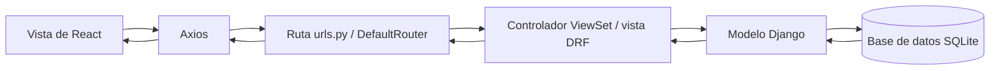
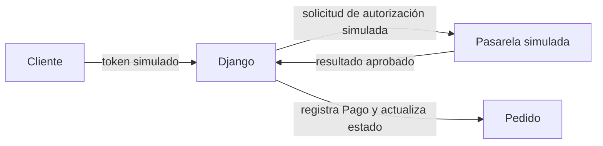

# Laboratorio 14 — Veterinaria Pet Care

## Ejercicio 1: componentes de la arquitectura

| componente | tecnología del curso que lo implementa | responsabilidad |
|---|---|---|
| base de datos | SQLite + Django ORM | Conserva productos, categorías, pedidos, detalles y pagos; el ORM representa las tablas como modelos y permite consultarlas. |
| rutas | `urls.py` / `DefaultRouter` | Asocia las URL de la API con las acciones de los ViewSet. |
| controladores | `views` / ViewSet de DRF | Reciben solicitudes, aplican validaciones y reglas del negocio y devuelven respuestas HTTP/JSON. |
| vistas | componentes de React: `pages` y `components` | Presentan la tienda veterinaria e información de productos y pedidos al usuario. |
| módulo de pago | modelo `Pago` + pasarela simulada | Registra monto, estado, referencia y fecha; simula la aprobación sin almacenar datos sensibles de tarjeta. |

### Borrador: Django view y React

En Django, una función `view` o un `ViewSet` recibe la solicitud HTTP y decide qué respuesta devolver; por eso cumple el papel de controlador de la lógica de la aplicación, aunque Django lo llame *view*. En esta aplicación, React cumple la función de presentar la interfaz que tradicionalmente se asociaría con un template: dibuja los componentes para el usuario y consume la API de Django, que intercambia los datos en JSON. Este texto es un borrador para reescribir con mis propias palabras.

## Ejercicio 2: modelos del catálogo

`catalogo/models.py` define `Categoria` con un nombre único y `Producto` con nombre, precio decimal, stock no negativo, estado activo y una clave foránea protegida hacia su categoría. El método `__str__` ofrece una representación legible de cada instancia.

| modelo | campo | tipo Django | equivalente SQL conceptual |
|---|---|---|---|
| Categoria | id | BigAutoField (PK) | integer, clave primaria autoincremental en SQLite |
| Categoria | nombre | CharField(max_length=100, unique=True) | varchar(100) UNIQUE NOT NULL |
| Producto | id | BigAutoField (PK) | integer, clave primaria autoincremental en SQLite |
| Producto | nombre | CharField(max_length=150) | varchar(150) NOT NULL |
| Producto | precio | DecimalField(max_digits=10, decimal_places=2) | decimal(10, 2) NOT NULL |
| Producto | stock | PositiveIntegerField | integer unsigned con CHECK >= 0 |
| Producto | activo | BooleanField(default=True) | boolean NOT NULL DEFAULT true |
| Producto | categoria | ForeignKey(Categoria, PROTECT) | categoria_id bigint con FOREIGN KEY hacia Categoria(id) |

### Comandos y salidas reales

Se ejecutaron desde `Semana 14`.

```text
> python manage.py makemigrations catalogo
Migrations for 'catalogo':
  catalogo\migrations\0001_initial.py
    + Create model Categoria
    + Create model Producto

> python manage.py migrate
Operations to perform:
  Apply all migrations: admin, auth, catalogo, contenttypes, sessions, veterinaria
Running migrations:
  Applying catalogo.0001_initial... OK
```

En el shell de Django se crearon 2 categorías y 5 productos con precios `Decimal`; el campo `stock` incluye un producto sin existencias para verificar la etiqueta de agotado.

```text
> python manage.py shell -c "from decimal import Decimal; from catalogo.models import Categoria, Producto; from django.db import connection; medicinas = Categoria.objects.create(nombre='Antiparasitarios y medicinas'); alimentos = Categoria.objects.create(nombre='Alimentos y accesorios'); Producto.objects.create(nombre='Pipeta antiparasitaria para perros 10-20 kg', precio=Decimal('35.90'), stock=18, categoria=medicinas); Producto.objects.create(nombre='Desparasitante oral para gatos', precio=Decimal('22.50'), stock=12, categoria=medicinas); Producto.objects.create(nombre='Vacuna antirrábica canina', precio=Decimal('48.00'), stock=8, categoria=medicinas); Producto.objects.create(nombre='Alimento seco para perros adultos 3 kg', precio=Decimal('64.90'), stock=15, categoria=alimentos); Producto.objects.create(nombre='Shampoo medicado veterinario 250 ml', precio=Decimal('31.75'), stock=0, categoria=medicinas); print('--- Producto.objects.all() ---'); [print(p.id, p.nombre, p.categoria.nombre, p.precio, p.stock, p.activo) for p in Producto.objects.all()]; print('--- PRAGMA table_info(catalogo_producto) ---'); cursor = connection.cursor(); cursor.execute('PRAGMA table_info(catalogo_producto)'); [print(fila) for fila in cursor.fetchall()]; print('--- SELECT * FROM catalogo_producto ---'); cursor.execute('SELECT * FROM catalogo_producto'); [print(fila) for fila in cursor.fetchall()]"
18 objects imported automatically (use -v 2 for details).

--- Producto.objects.all() ---
1 Pipeta antiparasitaria para perros 10-20 kg Antiparasitarios y medicinas 35.90 18 True
2 Desparasitante oral para gatos Antiparasitarios y medicinas 22.50 12 True
3 Vacuna antirr�bica canina Antiparasitarios y medicinas 48.00 8 True
4 Alimento seco para perros adultos 3 kg Alimentos y accesorios 64.90 15 True
5 Shampoo medicado veterinario 250 ml Antiparasitarios y medicinas 31.75 0 True
--- PRAGMA table_info(catalogo_producto) ---
(0, 'id', 'INTEGER', 1, None, 1)
(1, 'nombre', 'varchar(150)', 1, None, 0)
(2, 'precio', 'decimal', 1, None, 0)
(3, 'stock', 'integer unsigned', 1, None, 0)
(4, 'activo', 'bool', 1, None, 0)
(5, 'categoria_id', 'bigint', 1, None, 0)
--- SELECT * FROM catalogo_producto ---
(1, 'Pipeta antiparasitaria para perros 10-20 kg', 35.9, 18, True, 1)
(2, 'Desparasitante oral para gatos', 22.5, 12, True, 1)
(3, 'Vacuna antirr�bica canina', 48, 8, True, 1)
(4, 'Alimento seco para perros adultos 3 kg', 64.9, 15, True, 2)
(5, 'Shampoo medicado veterinario 250 ml', 31.75, 0, True, 1)
```

La consulta `Producto.objects.all()` equivale a `SELECT * FROM catalogo_producto;`. SQLite representa `DecimalField` como `decimal` y `PositiveIntegerField` como `integer unsigned` en esta tabla.

## Ejercicio 4: clientes, pedidos, detalles y pagos

No había un modelo `Cliente` en `veterinaria`, por lo que `pedidos/models.py` define `Cliente` para el pedido. `Pedido` guarda fecha, estado y total; `DetallePedido` conserva cantidad y precio unitario al comprar; `Pago` tiene una relación uno-a-uno con el pedido y solo guarda el token/referencia simulada, nunca los datos de la tarjeta.

| relación | opción `on_delete` | motivo |
|---|---|---|
| Producto → Categoria | PROTECT | Impide borrar una categoría que todavía clasifica productos. |
| DetallePedido → Producto | PROTECT | Conserva los productos referenciados por el historial de compra. |
| DetallePedido → Pedido | CASCADE | Elimina los detalles que no tienen sentido sin su pedido. |
| Pedido → Cliente | PROTECT | Conserva el cliente mientras existan pedidos asociados. |

### Protección de categoría

Se intentó borrar la categoría desde el shell; Django conservó sus productos y mostró esta salida:

```text
> python manage.py shell -c "from catalogo.models import Categoria; Categoria.objects.get(nombre='Antiparasitarios y medicinas').delete()"
22 objects imported automatically (use -v 2 for details).
Traceback (most recent call last):
  File "C:\Users\Daniela\Documents\4to ciclo\Desarrollo-Aplicaciones-Empresariales\Semana 14\manage.py", line 22, in <module>
    main()
    ~~~~^^
  File "C:\Users\Daniela\Documents\4to ciclo\Desarrollo-Aplicaciones-Empresariales\Semana 14\manage.py", line 18, in main
    execute_from_command_line(sys.argv)
    ~~~~~~~~~~~~~~~~~~~~~~~~~^^^^^^^^^^
  File "C:\Users\Daniela\AppData\Local\Programs\Python\Python313\Lib\site-packages\django\core\management\__init__.py", line 442, in execute_from_command_line
    utility.execute()
    ~~~~~~~~~~~~~~~^^
  File "C:\Users\Daniela\AppData\Local\Programs\Python\Python313\Lib\site-packages\django\core\management\__init__.py", line 436, in execute
    self.fetch_command(subcommand).run_from_argv(self.argv)
    ~~~~~~~~~~~~~~~~~~~~~~~~~~~~~~~~~~~~~~~~~~~~^^^^^^^^^^^
  File "C:\Users\Daniela\AppData\Local\Programs\Python\Python313\Lib\site-packages\django\core\management\base.py", line 420, in run_from_argv
    self.execute(*args, **cmd_options)
    ~~~~~~~~~~~~^^^^^^^^^^^^^^^^^^^^^^
  File "C:\Users\Daniela\AppData\Local\Programs\Python\Python313\Lib\site-packages\django\core\management\base.py", line 464, in execute
    output = self.handle(*args, **options)
  File "C:\Users\Daniela\AppData\Local\Programs\Python\Python313\Lib\site-packages\django\core\management\commands\shell.py", line 247, in handle
    exec(options["command"], {**globals(), **self.get_namespace(**options)})
    ~~~~^^^^^^^^^^^^^^^^^^^^^^^^^^^^^^^^^^^^^^^^^^^^^^^^^^^^^^^^^^^^^^^^^^^^
  File "<string>", line 1, in <module>
  File "C:\Users\Daniela\AppData\Local\Programs\Python\Python313\Lib\site-packages\django\db\models\base.py", line 1280, in delete
    collector.collect([self], keep_parents=keep_parents)
    ~~~~~~~~~~~~~~~~~^^^^^^^^^^^^^^^^^^^^^^^^^^^^^^^^^^^
  File "C:\Users\Daniela\AppData\Local\Programs\Python\Python313\Lib\site-packages\django\db\models\deletion.py", line 350, in collect
    raise ProtectedError(
    ...<7 lines>...
    )
django.db.models.deletion.ProtectedError: ("Cannot delete some instances of model 'Categoria' because they are referenced through protected foreign keys: 'Producto.categoria'.", {<Producto: Pipeta antiparasitaria para perros 10-20 kg>, <Producto: Desparasitante oral para gatos>, <Producto: Vacuna antirr�bica canina>, <Producto: Shampoo medicado veterinario 250 ml>})
```

La migración se creó y aplicó con éxito:

```text
> python manage.py makemigrations pedidos
Migrations for 'pedidos':
  pedidos\migrations\0001_initial.py
    + Create model Cliente
    + Create model Pedido
    + Create model Pago
    + Create model DetallePedido

> python manage.py migrate
Operations to perform:
  Apply all migrations: admin, auth, catalogo, contenttypes, pedidos, sessions, veterinaria
Running migrations:
  Applying pedidos.0001_initial... OK
```

## Ejercicio 5: serializador y ViewSet de productos

`ProductoSerializer` es un `ModelSerializer`: expone los campos del modelo y el identificador de categoría para escrituras. `categoria_nombre` se deriva de `categoria.nombre` y es de solo lectura. `validate_precio` genera `ValidationError` cuando el precio es menor o igual a cero.

`ProductoViewSet` hereda de `ModelViewSet`, usa el queryset de `Producto` (incluye la categoría relacionada), asocia el serializador, activa `SearchFilter` y busca el parámetro `?search=` en `nombre` del producto y `categoria__nombre`.

## Ejercicio 6: rutas de la API

`config/urls.py` registra `ProductoViewSet` en un `DefaultRouter` con el prefijo `productos`; el router se incluye bajo `api/`. También se incluye el URLconf de `pedidos` bajo `api/` y el de `veterinaria` en la raíz, por lo que continúan disponibles sus rutas previas, como `/api/servicios/`, `/api/insumos/` y `/api/citas/`.

| método y ruta | acción |
|---|---|
| GET `/api/productos/` | `list` |
| POST `/api/productos/` | `create` |
| GET `/api/productos/{id}/` | `retrieve` |
| PUT/PATCH `/api/productos/{id}/` | `update` / `partial_update` |
| DELETE `/api/productos/{id}/` | `destroy` |

Comprobación real con `runserver`:

```text
> python manage.py runserver 127.0.0.1:8000 --noreload
[28/Nov/2026 01:54:04] "GET /api/ HTTP/1.1" 200 52
[28/Nov/2026 01:54:04] "GET /api/productos/ HTTP/1.1" 200 800
[28/Nov/2026 01:54:05] "GET /api/servicios/ HTTP/1.1" 200 293

GET /api/                                      HTTP 200
{"productos":"http://127.0.0.1:8000/api/productos/"}

GET /api/productos/                           HTTP 200
[5 productos del catálogo]

GET /api/servicios/ (ruta veterinaria existente) HTTP 200
[5 servicios veterinarios]
```

## Ejercicio 7: CORS y catálogo React

En `config/settings.py`, `corsheaders` está en `INSTALLED_APPS`; `CorsMiddleware` está al inicio de `MIDDLEWARE`. Los orígenes permitidos son `http://localhost:5173` y `http://127.0.0.1:5173`. La comprobación real del preflight fue:

```text
OPTIONS /api/productos/ Origin: http://localhost:5173
HTTP 200
Access-Control-Allow-Origin: http://localhost:5173

OPTIONS /api/productos/ Origin: http://127.0.0.1:5173
HTTP 200
Access-Control-Allow-Origin: http://127.0.0.1:5173
```

`ProductosPage.jsx` consulta `api.get("productos/")` al montarse, muestra carga y un mensaje visible si la API no está disponible, y dibuja cada fila con `ProductoCard` y `key={producto.id}`. La tarjeta presenta nombre, categoría, precio con dos decimales y stock o “Agotado”. `App.jsx` abre el catálogo al iniciar y conserva accesible la pantalla previa de servicios veterinarios.

Validación real en el navegador con Vite y Django activos:

```text
{"titulo":"Veterinaria Pet Care | Productos","productosStatus":200,"serviciosStatus":200,"servicioVistaConservada":true}
```

## Ejercicio 8: flujo y protección de datos de pago

### Recorrido de una compra



### Flujo del pago simulado



**Datos que sí se guardan:** id del pedido, monto, estado del pago, token/referencia simulada y fecha. Los últimos cuatro dígitos podrían guardarse opcionalmente si una pasarela real los proporciona; esta implementación no los necesita.

**Datos que nunca se guardan ni se reciben en este flujo:** número completo de tarjeta, CVV/CVC y fecha de vencimiento. El endpoint de demostración acepta únicamente un token con prefijo `tok_sim_`.

### Creación del pedido y pago

`POST /api/pedidos/crear/` acepta `cliente_id` e `items`. Dentro de `transaction.atomic()` obtiene el precio vigente de la base de datos, bloquea las filas con `select_for_update()`, valida todos los productos y el stock, descuenta con `F("stock") - cantidad`, crea `Pedido` y `DetallePedido` y suma el total con `Decimal`. Los precios enviados por el cliente se ignoran. Un producto inexistente, inactivo o con stock insuficiente devuelve `400`; la transacción evita cambios parciales.

`POST /api/pedidos/{id}/pagar/` acepta únicamente `{ "token": "tok_sim_123" }`, crea `Pago` con el total del pedido y estado `APROBADO`, y cambia el pedido a `PAGADO`. Rechaza información adicional (incluidos campos de tarjeta) y un segundo pago de un pedido ya pagado.

Ejemplos manuales en PowerShell (se ejecutaron con cliente `1` y los productos del catálogo):

```text
> python manage.py shell -c "from pedidos.models import Cliente; cliente, creado = Cliente.objects.get_or_create(email='cliente.demo@petcare.test', defaults={'nombre': 'Cliente de demostración', 'telefono': '555000111'}); print('Cliente demo:', cliente.id, cliente.email, 'creado=' + str(creado))"
22 objects imported automatically (use -v 2 for details).
Cliente demo: 1 cliente.demo@petcare.test creado=True
```

```powershell
# Compra correcta; el campo precio enviado se ignora y se usa el precio guardado en Django.
$cuerpo = @{ cliente_id = 1; items = @(@{ producto_id = 1; cantidad = 2; precio = '0.01' }) } | ConvertTo-Json -Compress
$pedido = Invoke-RestMethod -Uri 'http://127.0.0.1:8000/api/pedidos/crear/' -Method Post -ContentType 'application/json' -Body $cuerpo

# Intento sin existencias.
$cuerpoSinStock = @{ cliente_id = 1; items = @(@{ producto_id = 5; cantidad = 1 }) } | ConvertTo-Json -Compress
try { Invoke-RestMethod -Uri 'http://127.0.0.1:8000/api/pedidos/crear/' -Method Post -ContentType 'application/json' -Body $cuerpoSinStock } catch { $_.ErrorDetails.Message }

# Pago simulado del pedido creado.
$cuerpoPago = @{ token = 'tok_sim_123' } | ConvertTo-Json -Compress
Invoke-RestMethod -Uri "http://127.0.0.1:8000/api/pedidos/$($pedido.id)/pagar/" -Method Post -ContentType 'application/json' -Body $cuerpoPago
```

Respuestas reales de las solicitudes en `runserver`:

```text
POST /api/pedidos/crear/ (2 unidades del producto 1; el cliente envió precio 0.01)
HTTP 201
{"id":2,"total":"71.80","estado":"PENDIENTE_PAGO"}

POST /api/pedidos/crear/ (1 unidad del producto 5, que tiene stock 0)
HTTP 400
{"stock":"Stock insuficiente para 'Shampoo medicado veterinario 250 ml': disponibles 0, solicitados 1."}

POST /api/pedidos/2/pagar/ con {"token":"tok_sim_123"}
HTTP 200
{"pedido_id":2,"monto":"71.80","estado_pago":"APROBADO","estado_pedido":"PAGADO","referencia":"tok_sim_123"}
```

### Pruebas y verificaciones reales

Las pruebas incluyen compra con stock suficiente y total calculado en el servidor, rechazo de stock insuficiente sin crear pedido ni cambiar stock, pago aprobado, rechazo de pago repetido y rechazo de datos de tarjeta.

```text
> python manage.py check
System check identified no issues (0 silenced).

> python manage.py test
Creating test database for alias 'default'...
............
----------------------------------------------------------------------
Ran 12 tests in 0.112s

OK
Destroying test database for alias 'default'...
Found 12 test(s).
System check identified no issues (0 silenced).

> cd frontend; npm run lint
> frontend@0.0.0 lint
> oxlint

> cd frontend; npm run build
> frontend@0.0.0 build
> vite build

vite v8.3.4 building client environment for production...
transforming...
✓ 79 modules transformed.
rendering chunks...
computing gzip size...
dist/index.html                   0.48 kB │ gzip:  0.30 kB
dist/assets/index-Bsa4NTC4.css    3.39 kB │ gzip:  1.25 kB
dist/assets/index-CxKNalhl.js   284.33 kB │ gzip: 91.45 kB

✓ built in 382ms
```
